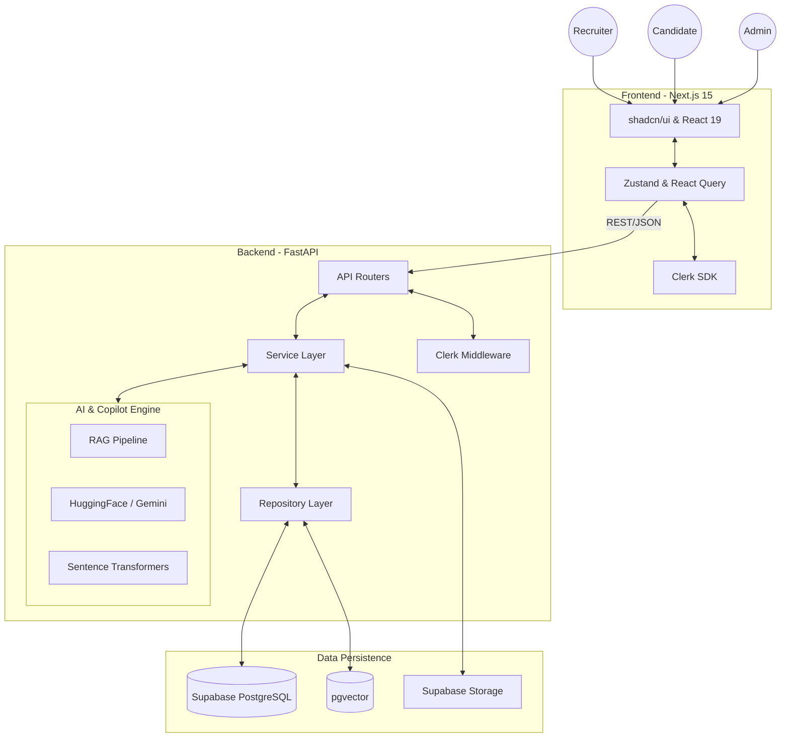
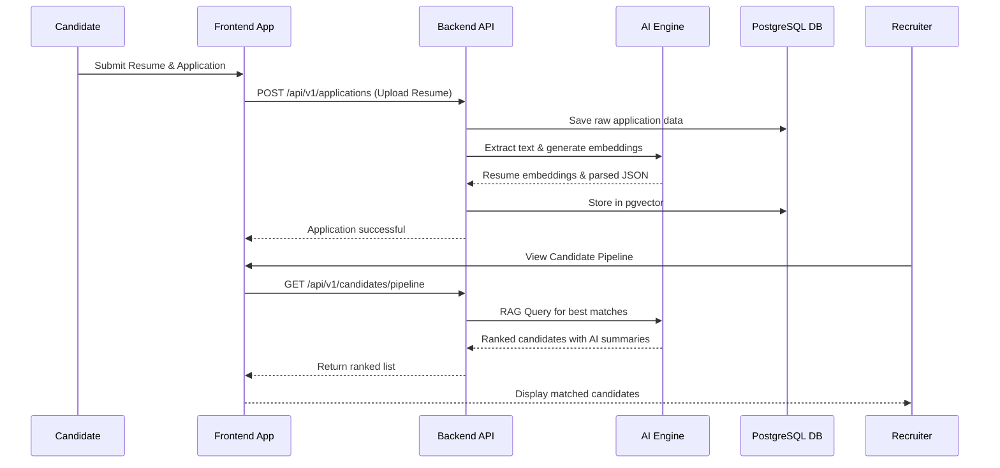

# HireMind AI

> **AI-Powered Hiring Copilot** — Enterprise SaaS platform that automates the complete hiring lifecycle for recruiters and candidates.

---

## 🌟 Core Features & Functionalities

HireMind AI is designed to streamline recruitment by leveraging artificial intelligence for candidate screening, workflow automation, and intelligent decision-making.

- **Intelligent Candidate Screening**: Automatically parse resumes and match candidates to job descriptions using AI.
- **Recruitment Copilot**: An AI assistant for recruiters to draft emails, summarize candidate profiles, and schedule interviews.
- **Modular Monolithic Architecture**: Highly scalable and maintainable codebase structure separating concerns logically.
- **Role-Based Access Control (RBAC)**: Secure access for Admins, Recruiters, and Candidates.
- **Real-Time Analytics**: Dashboard providing insights into hiring metrics, time-to-hire, and pipeline health.

---

## 🏗️ System Architecture

The application follows a **Modular Monolith** architecture with a clear separation between the frontend and backend layers, ensuring scalability while keeping deployment manageable.



---

## 🔄 Core Workflow & System Design

The typical recruitment workflow is automated and enhanced by AI at every step.



---

## 🛠️ Technology Stack

| Layer | Technology |
|---|---|
| **Frontend** | Next.js 15 (App Router), React 19, TypeScript, TailwindCSS, shadcn/ui |
| **Backend** | FastAPI, Python 3.12+, Pydantic v2, SQLAlchemy 2.0, Alembic |
| **Database** | Supabase PostgreSQL + pgvector |
| **Authentication** | Clerk |
| **Storage** | Supabase Storage |
| **AI** | HuggingFace Inference API, Sentence Transformers, Gemini |
| **Deployment** | Vercel (frontend), Render (backend) |

---

## 📂 Repository Structure

```text
recruit/
├── docs/               # Architecture, PRD, engineering docs
├── frontend/           # Next.js 15 application
│   └── src/
│       ├── app/        # App Router pages and layouts
│       ├── components/ # Shared and feature UI components
│       ├── features/   # Feature-scoped modules
│       ├── services/   # API service layer
│       └── stores/     # Zustand state stores
├── backend/            # FastAPI application
│   └── app/
│       ├── api/        # Route handlers (v1/copilot, v1/rag)
│       ├── core/       # App configuration and startup
│       ├── models/     # SQLAlchemy ORM models
│       ├── services/   # Business logic layer
│       └── ai/         # AI/ML providers (Gemini, HuggingFace)
├── shared/             # Cross-cutting types, schemas, constants
├── scripts/            # Developer build and utility scripts
└── .github/            # CI/CD workflows and PR templates
```

---

## 🚀 Getting Started

### Frontend Setup

```bash
cd frontend
npm install
npm run dev
```

### Backend Setup

```bash
cd backend
python -m venv venv
venv\Scripts\activate   # Windows
# source venv/bin/activate  # macOS/Linux
pip install -r requirements.txt
uvicorn app.main:app --reload
```

---

## 🔐 Environment Variables

Copy the example files and fill in your values:

```bash
cp frontend/.env.example frontend/.env.local
cp backend/.env.example backend/.env
```

---

## 📄 Documentation & Contribution

- Full documentation is available in the [`docs/`](./docs/) directory.
- See our [Contributing Guidelines](./docs/engineering/Contributing.md) for coding standards.
- MIT License — see [`LICENSE`](./LICENSE).
