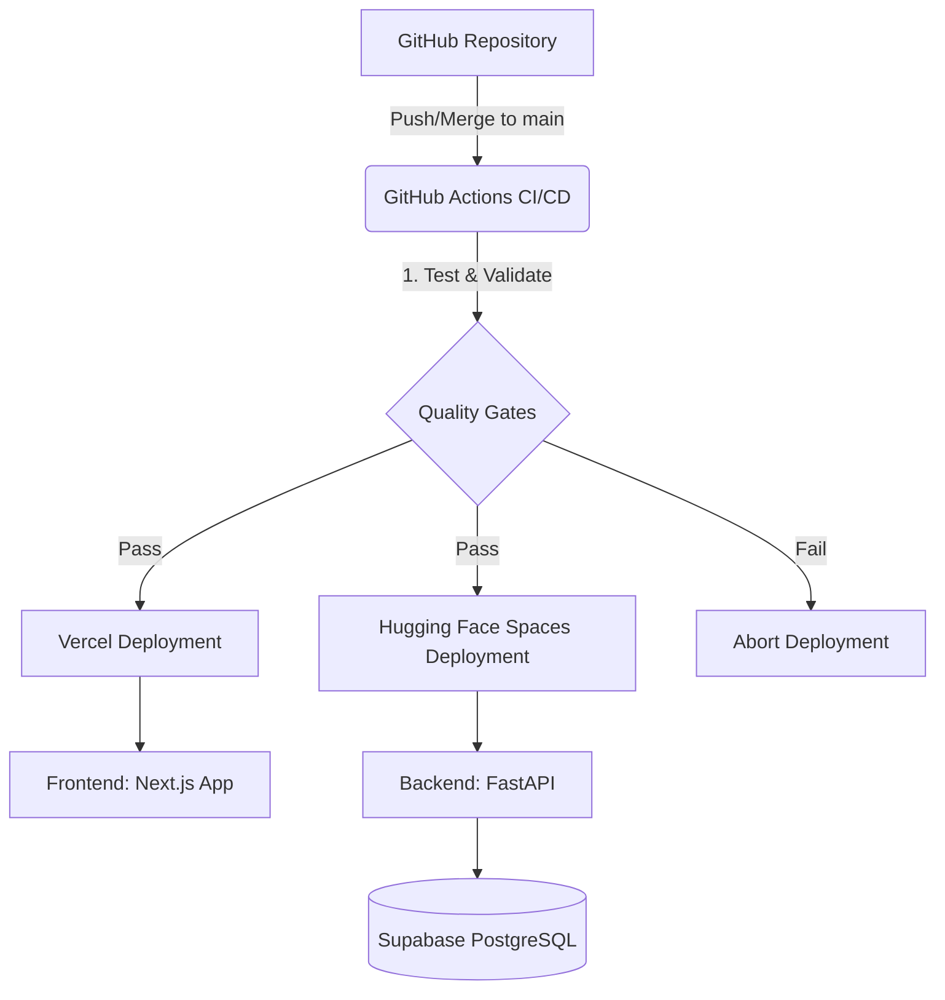

# Deployment Overview

HireMind AI utilizes a modern, serverless, free-tier-optimized deployment strategy. We leverage GitHub Actions as our CI/CD orchestrator, Vercel for our Next.js frontend, and Hugging Face Spaces for our FastAPI backend.

## Architecture

## Rollback Strategy

Because we rely on fully managed PaaS platforms, rollbacks are handled through version control and platform-native features.

1. **Frontend Rollback (Vercel):**
   - Vercel automatically creates a unique URL for every deployment.
   - To rollback immediately, navigate to the Vercel Dashboard -> Deployments, click the ellipsis next to the previous stable deployment, and select **"Promote to Production"**.
   - Alternatively, use `git revert` on `main` and push, which triggers a new deployment of the previous state.

2. **Backend Rollback (Hugging Face Spaces):**
   - Hugging Face Spaces syncs with the Git state.
   - To rollback, simply use `git revert` on the `main` branch of your GitHub repository and push. The GitHub Action will deploy the reverted state.
   - Alternatively, you can use the Hugging Face UI to revert to a previous commit directly in the Spaces "Files" tab.

3. **Database Migration Rollback:**
   - If an Alembic migration fails in production, do **not** run `alembic downgrade` unless absolutely necessary, as it may result in data loss.
   - Restore the database from the most recent Supabase automated backup via the Supabase Dashboard -> Database -> Backups.

## Monitoring & Health Checks

After a deployment, you can verify system health using the built-in observability endpoints:

- **Liveness Check**: `GET /api/v1/health` ensures the FastAPI server is running.
- **Readiness Check**: `GET /api/v1/health/ready` ensures that database connections, AI providers, and background workers are fully operational.
